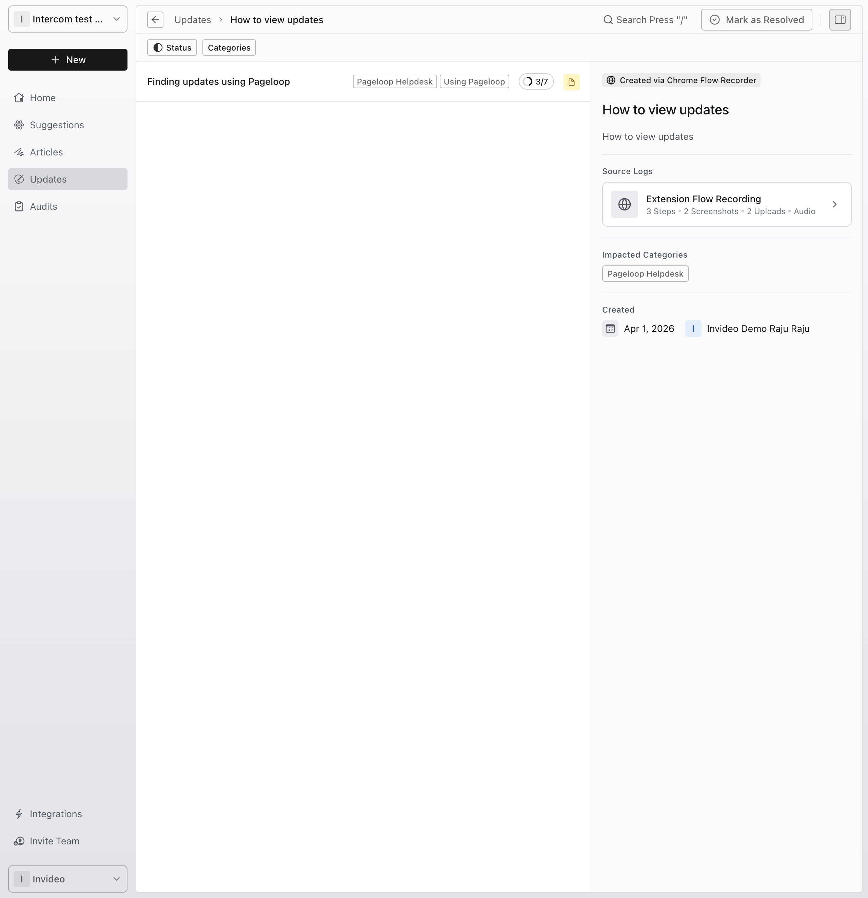

Keeping your documentation accurate is effortless with Pageloop. When product changes occur, Pageloop automatically generates suggested updates for your articles. This guide walks you through how to review, evaluate, and accept these proposed text and image changes.

# Navigate to your updates

To begin reviewing the AI-generated suggestions, you first need to access the Updates view.

1. From the left-hand navigation menu, click **Updates** to display a list of all pending updates in your workspace.

2. Click on a specific update from the list to open its detail page. This page displays all the articles impacted by this specific update.

   <Frame>
     
   </Frame>

# Review and accept changes

Once you select an impacted article, you enter an experience where you can compare the proposed changes against your existing content.

1. Click on one of the impacted articles to open it and review the suggested modifications.

2. To review a text change, click directly on the highlighted text within the article, or click the **Replace Text** item in the right-side navigation panel. This opens a dialog that displays the reasoning behind the change and the exact replacement text.

3. To review image updates, click **Replace Screenshot** in the side navigation panel. This opens a dialog showing the new screenshot that will replace the outdated visual.

# Next Steps

After reviewing and accepting the necessary text and image changes, your article is ready for the next phase. To learn more about finalizing and publishing your content, explore our guide on [Reviewing and approving content on the Updates page](/pageloop-helpdesk/reviewing-and-approving-content-on-the-updates-page).
